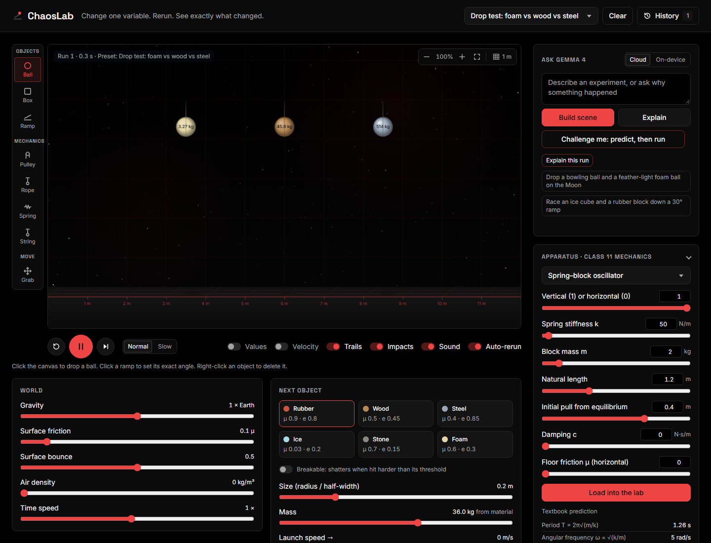
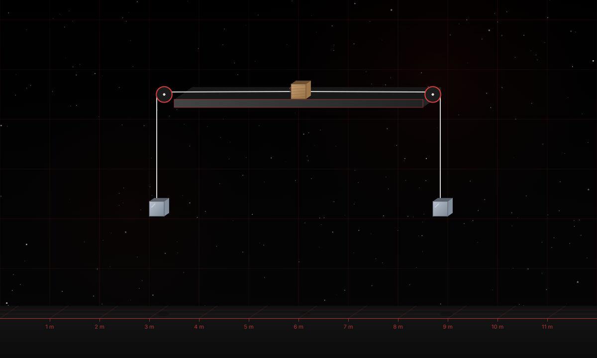
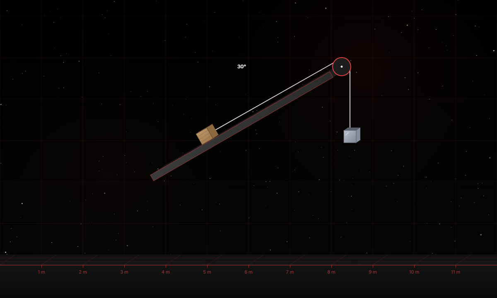
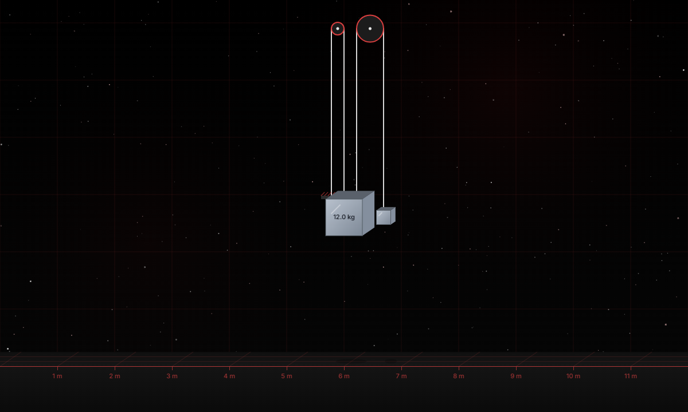
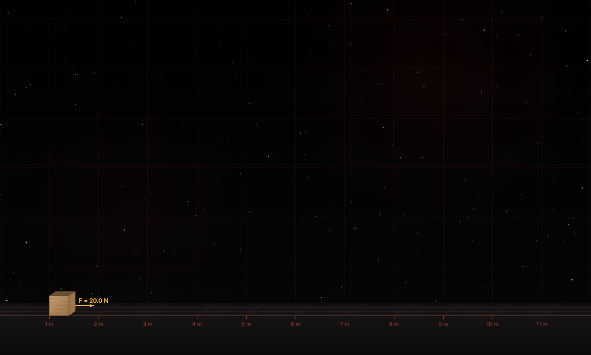
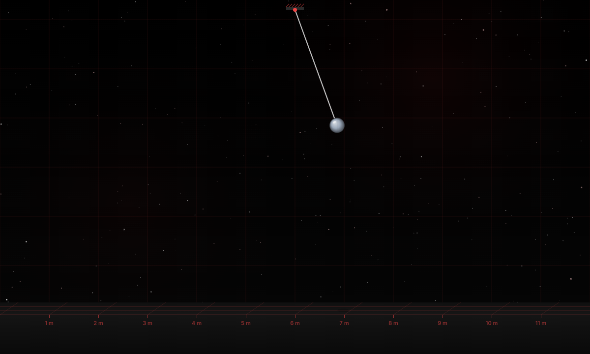
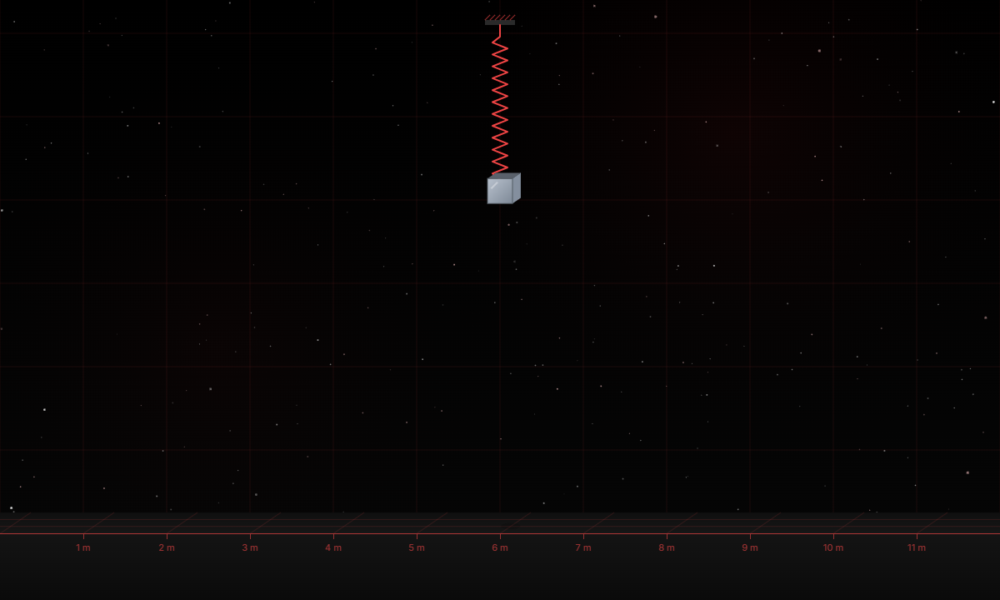
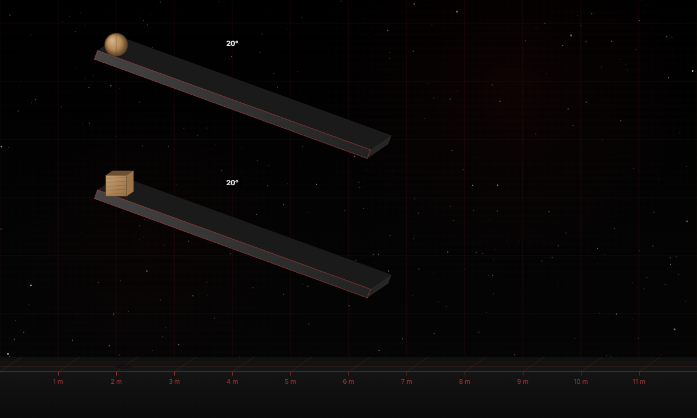

# ChaosLab

**Describe a physics experiment in plain words. Gemma 4 builds it, the simulation runs it, and Gemma explains what happened using the numbers the simulation actually measured.**

ChaosLab is a browser physics sandbox for experimenting without equations. Drop balls, boxes and ramps, pick what they are made of, change gravity, friction or air density, and rerun. Every run is recorded, so you can compare it with the previous one and ask *why* it changed. For Class 11 and JEE students it also loads standard mechanics apparatus, from springs and pendulums to multi-pulley systems, and checks the textbook answer against the simulation.

Built during **Hacktoberfest x MOSS Hack Day Udupi** (MIT Manipal, 25 October 2026, 10:00 AM to 5:00 PM IST) for the **Best Use of Gemma 4** and **Best Open-Source AI Project** challenges.



## Highlights

| | |
|---|---|
| **Type a problem, get an experiment.** Gemma 4 turns plain sentences and JEE-style questions into scenes and apparatus through function calling. | **Textbook vs measured.** Every apparatus shows the textbook prediction next to the value measured live from the simulation. |
| **13 Class 11 apparatus**, every parameter adjustable: springs, pendulums, Atwood, pulleys on tables and inclines, block and tackle, forces at an angle with friction, contact blocks, collisions, projectiles. | **Build your own mechanics.** Pulleys, ropes, springs and strings in any scene, draggable, with live coordinates. |
| **Predict, then run.** Gemma designs a question where intuition fails; the physics decides the answer. | **Works offline.** Gemma 4 E4B on-device through Ollama, with automatic fallback when the cloud is busy. |

## Try these prompts

Type any of these into **Ask Gemma 4** and press **Build scene**:

- Two masses 5 kg and 3 kg are connected by a light inextensible string passing over a smooth pulley. Find the acceleration and tension.
- A 10 kg block rests on a rough table (coefficient of friction 0.2) and is tied over a pulley to a 3 kg hanging mass. Will it move?
- Two blocks of 4 kg and 7 kg are in contact on a smooth floor. A 17 N force pushes the 4 kg block. Find the contact force.
- A block and tackle with 4 pulleys lifts a 40 kg load using a 12 kg effort mass. Then: *add 2 more pulleys*
- Race an ice cube and a rubber block down two 30° ramps
- make a complex maze for a steel ball

## Screenshots

| | |
|---|---|
|  |  |
| Two pulleys, three blocks (m₁ and m₃ hanging, m₂ on a table with friction) | Block on an incline tied over a pulley to a hanging mass |
|  |  |
| Block and tackle with 2 to 6 pulleys | Block pushed or pulled by a force at an angle, with friction |
|  |  |
| Single or double pendulum | Spring–block oscillator, vertical or horizontal |
|  | |
| Rolling versus sliding down exact-angle ramps | |

## What it does

- **Build scenes from text.** "Race an ice cube and a rubber block down two 30° ramps" or "make a complex maze" becomes a running experiment through Gemma 4 function calling. Mazes are different on every build and are checked by running the physics ahead, so the ball reaches the bottom.
- **Solve JEE-style problems.** Paste a question such as "Two blocks of 4 kg and 7 kg are in contact on a smooth floor; a 17 N force pushes the 4 kg block" and Gemma loads the matching apparatus with the problem's numbers. Follow-ups like "add 2 more pulleys" or "make the load 15 kg" edit the current setup instead of starting over.
- **Class 11 mechanics apparatus.** Spring–block, pendulum (single or double), Atwood machine, block pushed or pulled by a force at an angle with friction, two blocks in contact, block on a table or incline tied over a pulley, two pulleys with three blocks, movable pulley, block and tackle, 1D collision, projectile and block on an incline. Each shows the textbook prediction (acceleration, tension, period, range, normal force) next to the value measured live with a least-squares fit of the motion.
- **Build your own mechanics.** A tool rail with Ball, Box, Ramp, Pulley, Rope, Spring, String and Grab. Ropes wrap around pulley discs and can go slack; springs follow Hooke's law with damping. Drag pulleys and anchors and see their coordinates live.
- **Explanations grounded in data.** Gemma receives the measured telemetry of the current run (and the previous run when comparing) plus a screenshot of the canvas, then explains the result quoting real numbers, with a before/after table and a suggested next experiment.
- **Predict-then-run challenges.** Gemma designs a scene and a question; you guess, the simulation runs, and the correct answer is measured from the physics, not decided by the model. Gemma then explains why, taking your guess into account.
- **Real-feeling physics.** Six materials (rubber, wood, steel, ice, stone, foam) with their own friction, bounce, density and toughness; quadratic air drag; Coulomb friction; correct rolling; textbook collision impulses.
- **Breakable objects.** Objects shatter into simulated fragments when one impact delivers more energy than their threshold (toughness × mass).
- **PhET-style controls.** Rerun, play/pause, step forward, normal or slow motion, zoom, grid spacing, speed labels on every object, and a history drawer of runs with a chart comparing them.
- **Works offline.** Switch to *On-device* to run Gemma 4 E4B locally through Ollama. The cloud mode also falls back to it automatically when the free tier is rate-limited or unavailable.

## How well it works

- **Simulator vs textbook:** a built-in self-test ([`public/selftest.js`](public/selftest.js)) generates random JEE-style problems for every apparatus; 192 of 200 matched the textbook answer.
- **Gemma vs real questions:** tested on 40 JEE-style wordings and on Newton's-laws questions from a practice set (pushed crates, contact blocks, angled pulls with friction, pulleys).
- **Mazes:** 36 of 36 random mazes reach the bottom.

## Team

| Name | GitHub |
|---|---|
| Abhiraj Mandal | [@NyteZoid](https://github.com/NyteZoid) |
| Prithu Pandey | [@prithu9454](https://github.com/prithu9454) |
| Kanishk Rai | [@syncwhale](https://github.com/syncwhale) |
| Vikas Agarwal | [@polymorphicblob](https://github.com/polymorphicblob) |

## Models used

| Model | How it is used | Licence / terms |
|---|---|---|
| **Gemma 4 26B A4B instruction-tuned** (`gemma-4-26b-a4b-it`), open-weight, by Google DeepMind | Main model, called through the **Gemini API** | [Apache 2.0](https://www.apache.org/licenses/LICENSE-2.0); also the [Gemma Terms of Use](https://ai.google.dev/gemma/terms) and [Prohibited Use Policy](https://ai.google.dev/gemma/prohibited_use_policy) |
| **Gemma 4 E4B** (`gemma4:e4b` in [Ollama](https://ollama.com/library/gemma4)), open-weight | Optional on-device / offline mode and automatic fallback | Same as above |

Gemma 4 overview and docs: https://ai.google.dev/gemma

## How we call Gemma 4 through the Gemini API

All calls go through our server ([`gemma.js`](gemma.js)) so the API key never reaches the browser. The server sends `POST https://generativelanguage.googleapis.com/v1beta/models/gemma-4-26b-a4b-it:generateContent` with the key in the `x-goog-api-key` header, in three ways:

1. **Build a scene (function calling).** The request includes a system instruction, the user's sentence, a short summary of the current scene, and two function declarations, `build_scene` and `edit_scene`, with `toolConfig.functionCallingConfig.mode = "ANY"` so Gemma must answer with a tool call. The tool arguments (a checklist, structures such as a zigzag ramp path, ramps and groups of objects) are turned into exact positions by [`public/layout.js`](public/layout.js). Follow-up requests also send the previous requests, what happened in the current run and a screenshot of the canvas, so Gemma can fix the scene you are looking at. Ramp paths are then checked by running the physics ahead invisibly. See `build()` and `BUILD_TOOLS` in [`gemma.js`](gemma.js).
2. **Predict-then-run challenges (function calling).** A `make_challenge` function declaration asks Gemma for a scene plus a neutral question (which object hits the floor first, travels farthest, bounces highest or shatters). ChaosLab measures the correct answer by running the physics ahead invisibly; the model never decides it. See `challenge()` in [`gemma.js`](gemma.js) and [`public/challenge.js`](public/challenge.js).
3. **Explain a result (multimodal input, JSON output).** The request includes the measured telemetry as JSON **and a JPEG screenshot of the simulation canvas** (`inlineData`), with `responseMimeType: "application/json"` and a `responseSchema` so Gemma returns a headline, an explanation, a table of numbers and a suggested next experiment. See `explain()` and `EXPLAIN_SCHEMA` in [`gemma.js`](gemma.js).

All use `thinkingConfig.thinkingLevel = "minimal"` for speed. If the Gemini API is rate-limited, errors or times out, the same request is sent to the local Gemma 4 E4B through Ollama's `/api/chat` endpoint, and the answer is labelled as on-device.

## How Gemma 4 is used

| Feature | Gemma 4 capability | Where |
|---|---|---|
| Text to scene | Function calling (`build_scene`, `edit_scene`) | [`gemma.js`](gemma.js), [`public/layout.js`](public/layout.js) |
| Explanations | Structured JSON output + image input (canvas screenshot) | [`gemma.js`](gemma.js), [`public/assistant.js`](public/assistant.js) |
| Offline mode | Open weights (`gemma4:e4b`) via Ollama | [`gemma.js`](gemma.js) |

Three design choices make the model reliable:

1. **Gemma describes, code computes.** Language models are poor at coordinate maths, so Gemma never writes positions. It describes groups ("3 wooden boxes, stack, bottom of ramp A") and [`layout.js`](public/layout.js) works out exact positions. A required `checklist` argument, written first, makes the model list every requested object before describing it, which stops it dropping objects.
2. **Grounded in solved examples and real data.** Each request carries the most similar solved problems from [`data/examples.json`](data/examples.json); if a number from the problem goes unused, Gemma is asked once more; and planets and moons use surface gravity and air density from NASA fact sheets.
3. **Explanations only use measured data.** The prompt includes per-object outcomes (peak speed, bounce heights, impact energy, whether it shattered) and the physics rules the simulation uses, and forbids inventing numbers.

## Run it locally

Requirements: [Node.js](https://nodejs.org/) 20 or newer. Optional: [Ollama](https://ollama.com/) for on-device mode.

```bash
git clone https://github.com/NyteZoid/chaoslab.git
cd chaoslab
npm install
cp .env.example .env      # then put your Gemini API key in .env
npm start
```

Open http://localhost:3000.

For on-device mode:

```bash
ollama pull gemma4:e4b
```

To use the phone camera later (sketch to scene), browsers require HTTPS. Put a self-signed `key.pem` and `cert.pem` in `certs/` and the server also listens on https port 3443.

## Project structure

```
server.js            static server + /api endpoints (keeps the API key server-side)
gemma.js             Gemma 4 prompts, tools and providers (Gemini API and Ollama)
public/
  index.html         page structure
  style.css          design tokens and styles
  ui.js              wires controls, chart and telemetry readout
  lab.js             physics: Matter.js engine, friction, air drag, fracture, scene spec
  render.js          pseudo-3D canvas renderer, effects
  telemetry.js       records runs and builds the data Gemma explains
  layout.js          turns Gemma's scene description into exact positions
  links.js           springs, rods and pulley ropes
  apparatus.js       Class 11 mechanics setups with textbook predictions
  apparatus-panel.js the Apparatus panel and live measurements
  selftest.js        random JEE-style problems checked against textbook answers
  challenge.js       predict-then-run challenges
  assistant.js       the Ask Gemma panel
  materials.js       material properties
  presets.js         starter experiments
  sound.js           synthesised impact and shatter sounds
```

## Physics notes

- Units are SI throughout: metres, kilograms, seconds. 1 m = 100 px.
- Friction is our own Coulomb model (μ·N per contact) because Matter.js friction is not proportional to the normal force. A box on a 20° ramp accelerates at the textbook value.
- Air drag is quadratic, F = ½·ρ·Cd·A·v², so light, large objects are slowed most.
- Balls are 160-sided polygons so they roll smoothly; inertia uses the real moment rather than Matter.js's 4× default.
- When two surfaces touch, friction and bounce are the geometric mean of both.
- Impact energy for fracture is ½·μ·v², with μ the reduced mass and v the closing speed along the contact normal.

## Known limitations

- The free Gemini API tier allows about 16,000 input tokens a minute (roughly 5 or 6 Gemma requests). Beyond that ChaosLab answers on-device, which is slower.
- Gemma 4 E4B (on-device) is noticeably less accurate than the cloud 26B model at building scenes and explaining them.
- Scene building is much better than raw coordinates but not perfect; rephrasing usually fixes a wrong scene.

## Libraries, services and assets

- [Matter.js](https://github.com/liabru/matter-js) 0.20.0, 2D physics engine (MIT). Our friction, air drag, rolling and fracture code sits on top of it.
- [Gemini API](https://ai.google.dev/gemini-api/docs), used to call Gemma 4 (free tier).
- [Ollama](https://ollama.com/) (MIT), optional, runs Gemma 4 E4B locally.
- [Inter](https://fonts.google.com/specimen/Inter) and [Space Grotesk](https://fonts.google.com/specimen/Space+Grotesk) fonts via Google Fonts (SIL Open Font License).
- Node.js built-in modules only on the server; no other npm dependencies.
- [NASA planetary fact sheets](https://nssdc.gsfc.nasa.gov/planetary/factsheet/) (public domain) for surface gravity and air density.
- No other datasets are used; the solved examples in `data/examples.json` were written by us.

## AI coding tools used

We used AI to help build this project, and we want to be clear about what it produced.

- **Claude Code** (Anthropic, model Claude Opus 5.5), used as a coding assistant throughout the event. Under our direction it wrote most of the code and documentation in this repository: the server and Gemini/Ollama integration (`server.js`, `gemma.js`), the physics additions (friction, air drag, rolling, fracture in `public/lab.js`), the renderer, telemetry, layout engine, Gemma panel, UI, styles, sounds, this README and the CHANGELOG. It also ran the tests we used to check physics against textbook values and to test Gemma's scene building.
- **Our part:** we chose the idea and its direction, decided which features to build and in what order, supplied the design guidelines the UI follows, reviewed and tested the app as we went, reported the problems we found (for example wrong scenes from Gemma, the invisible prompt text and the unrealistic hit-stop) and asked for the breakable-objects feature.

Commits co-written with Claude Code carry a `Co-Authored-By: Claude` line.

No other AI tools were used.

## Licence

[MIT](LICENSE)
