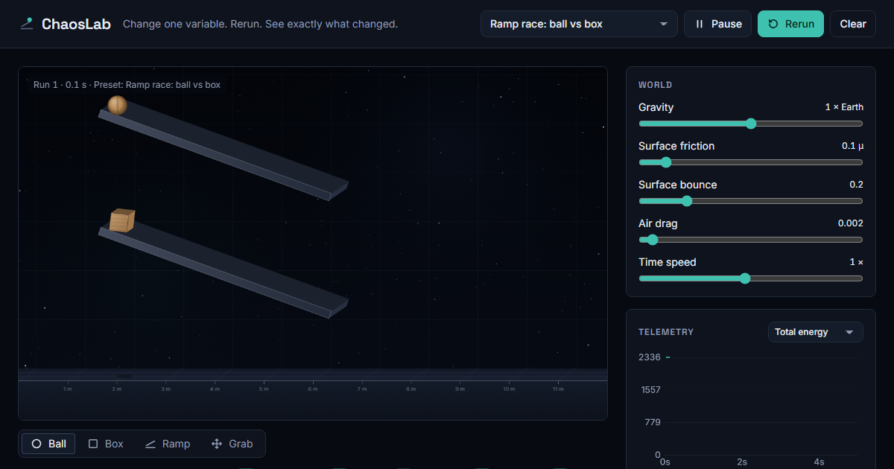

# ChaosLab

**Describe a physics experiment in plain words. Gemma 4 builds it, the simulation runs it, and Gemma explains what happened using the numbers the simulation actually measured.**

ChaosLab is a browser physics sandbox for experimenting without equations. Drop balls, boxes and ramps, pick what they are made of, change gravity, friction or air density, and rerun. Every run is recorded, so you can compare it with the previous one and ask *why* it changed.

Built at **Hacktoberfest Hack Day Udupi × MOSS** (MIT Manipal, 25 October 2026), an open-source AI hackathon.



## What it does

- **Build scenes from text.** "Race an ice cube and a rubber block down two 30° ramps" becomes a running experiment through Gemma 4 function calling.
- **Explanations grounded in data.** Gemma receives the measured telemetry of the current run (and the previous run when comparing) plus a screenshot of the canvas, then explains the result quoting real numbers, with a before/after table and a suggested next experiment.
- **Real-feeling physics.** Six materials (rubber, wood, steel, ice, stone, foam) with their own friction, bounce, density and toughness; quadratic air drag; Coulomb friction; correct rolling.
- **Breakable objects.** Objects shatter into fragments when one impact delivers more energy than their threshold (toughness × mass). Fragments are fully simulated and can break again.
- **Compare runs.** Moving a slider reruns the scene from the same starting point and overlays the new run on the old one in the chart.
- **Works offline.** Switch to *On-device* to run Gemma 4 E4B locally through Ollama. The cloud mode also falls back to it automatically when the free tier is rate-limited or unavailable.

## How Gemma 4 is used

| Feature | Gemma 4 capability | Where |
|---|---|---|
| Text to scene | Function calling (`build_scene`, `edit_scene`) | [`gemma.js`](gemma.js), [`public/layout.js`](public/layout.js) |
| Explanations | Structured JSON output + image input (canvas screenshot) | [`gemma.js`](gemma.js), [`public/assistant.js`](public/assistant.js) |
| Offline mode | Open weights (`gemma4:e4b`) via Ollama | [`gemma.js`](gemma.js) |

Two design choices make the model reliable:

1. **Gemma describes, code computes.** Language models are poor at coordinate maths, so Gemma never writes positions. It describes groups ("3 wooden boxes, stack, bottom of ramp A") and [`layout.js`](public/layout.js) works out exact positions. A required `checklist` argument, written first, makes the model list every requested object before describing it, which stops it dropping objects.
2. **Explanations only use measured data.** The prompt includes per-object outcomes (peak speed, bounce heights, impact energy, whether it shattered) and the physics rules the simulation uses, and forbids inventing numbers.

## Run it locally

Requirements: [Node.js](https://nodejs.org/) 20 or newer. Optional: [Ollama](https://ollama.com/) for on-device mode.

```bash
git clone <this repository>
cd chaoslab
npm install
cp .env.example .env      # then put your Gemini API key in .env
npm start
```

Open http://localhost:3000.

For on-device mode:

```bash
ollama pull gemma4:e4b
```

To use the phone camera later (sketch to scene), browsers require HTTPS. Put a self-signed `key.pem` and `cert.pem` in `certs/` and the server also listens on https port 3443.

## Project structure

```
server.js            static server + /api endpoints (keeps the API key server-side)
gemma.js             Gemma 4 prompts, tools and providers (Gemini API and Ollama)
public/
  index.html         page structure
  style.css          design tokens and styles
  ui.js              wires controls, chart and telemetry readout
  lab.js             physics: Matter.js engine, friction, air drag, fracture, scene spec
  render.js          pseudo-3D canvas renderer, effects
  telemetry.js       records runs and builds the data Gemma explains
  layout.js          turns Gemma's scene description into exact positions
  assistant.js       the Ask Gemma panel
  materials.js       material properties
  presets.js         starter experiments
  sound.js           synthesised impact and shatter sounds
```

## Physics notes

- Units are SI throughout: metres, kilograms, seconds. 1 m = 100 px.
- Friction is our own Coulomb model (μ·N per contact) because Matter.js friction is not proportional to the normal force. A box on a 20° ramp accelerates at the textbook value.
- Air drag is quadratic, F = ½·ρ·Cd·A·v², so light, large objects are slowed most.
- Balls are 160-sided polygons so they roll smoothly; inertia uses the real moment rather than Matter.js's 4× default.
- When two surfaces touch, friction and bounce are the geometric mean of both.
- Impact energy for fracture is ½·μ·v², with μ the reduced mass and v the closing speed along the contact normal.

## Known limitations

- The free Gemini API tier allows about 16,000 input tokens a minute (roughly 5 or 6 Gemma requests). Beyond that ChaosLab answers on-device, which is slower.
- Gemma 4 E4B (on-device) is noticeably less accurate than the cloud 26B model at building scenes and explaining them.
- Scene building is much better than raw coordinates but not perfect; rephrasing usually fixes a wrong scene.

## Credits

- Physics engine: [Matter.js](https://github.com/liabru/matter-js) (MIT).
- Language model: [Gemma 4](https://ai.google.dev/gemma) by Google DeepMind.

## Licence

[MIT](LICENSE)
